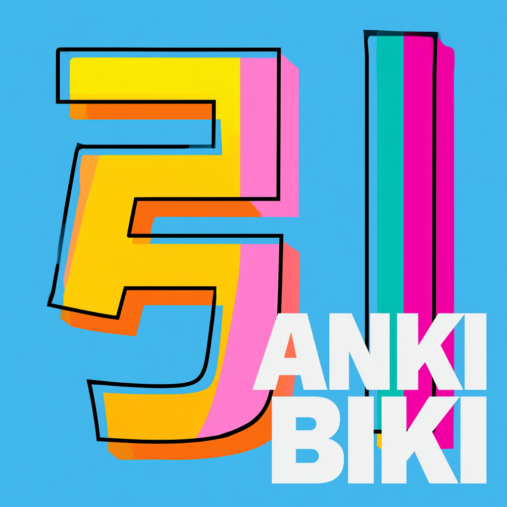

#  AnkiBiki

<p align="center">
  
</p>

A personal Android dictionary + mining app (Pixel 10 Pro XL). The 引き tab searches your own
Anki cards live via AnkiDroid, with an offline dictionary fallback and Chinese pronunciation
audio; the 採掘 tab mines Japanese sentences out of screenshots — OCR, sentence parsing, word
and grammar extraction, a correction gate, and a wizard that turns reviewed items into real
AnkiDroid cards.

Searches two decks directly out of AnkiDroid's live collection:

- **🇨🇳 RSH1 Hanzi** ("中文") — Chinese hanzi with mnemonics, pinyin, and pronunciation audio
- **01 NihongoShark.com: Kanji** ("日本語") — Japanese kanji with mnemonics and readings

If nothing in your decks matches, results fall back to a bundled offline dictionary
(KANJIDIC2 + JMdict + RADKFILE for Japanese, CC-CEDICT for Chinese — see
[ATTRIBUTION.md](ATTRIBUTION.md)).

## Photo mining & extraction

Screenshots picked up from the camera roll go through: language tagging -> on-device ML Kit
OCR -> `CjkSentenceParser` (sentence stitching) -> Kuromoji word analysis + grammar catalogue
-> deduplicated occurrences per sentence. Every photo keeps its raw OCR document, its parsed
text, your manual edits (provenance-flagged), and the source image.

**Correction gate (auto-apply):** when `CLOUD_VISION_API_KEY` is configured, each Japanese
photo also gets one Cloud Vision read at mining time; where the two readers disagree on a
kanji island, the S003-D' gate (dictionary anchoring + glyph-confusability, nameplate-adjacent
islands excluded) auto-applies only the fixes it can evidence from JMdict. Local ML Kit keeps
authoritative segmentation — cloud geometry is never adopted. Offline or unconfigured = pure
local pipeline. Every evaluated island, applied or not, is logged to the `ocr_corrections`
audit table (reversible per write). Kill switch: `PipelineConfig.ocrCorrectionEnabled`.

**Gold standard:** marking a photo 金 (its button, filled when set) is the *only* thing that
makes it benchmark gold — membership is declared, not inferred from edits. The JVM harness
(`GoldBenchmarkTest`) scores sentence-exact / segmentation / char-accuracy against the marked
set; iteration plan + baselines live in [docs/benchmarks/](docs/benchmarks/).

## Cloud processing & privacy

With a Cloud Vision key configured, each mined Japanese photo's image bytes are uploaded to
Google Cloud Vision (DOCUMENT_TEXT_DETECTION) once at mining time — ~1 request/photo, 1,000
free per month. Without the key, nothing leaves the device. The photo view always shows which
provider produced the text, and gate corrections are annotated in the stored document note.

## Project direction

See [the improvement roadmap](docs/roadmap.md) — status tracks, acceptance criteria,
and the parked/active split. The text-processing pipeline is **parked** as of
2026-11-13; [docs/extraction-pipeline-state.md](docs/extraction-pipeline-state.md)
is the snapshot + re-entry kit for when it resumes. Historical designs:
[photo mining](docs/saikutsu-photo-mining-plan.md),
[card wizard](docs/card-creation-wizard-plan.md),
[Chinese word/hanzi sync](docs/chinese-word-hanzi-sync-plan.md).

## Corpus data & recovery

Photo mining writes to `mining.db`, the app's private database on the device: scraped
photos + extracted text, learned words/grammar with visibility states, and per-sentence
review decisions (seen/deleted/user-edited). **This database is the only copy of that
work**, and Android deletes it on uninstall — an instrumented test once wiped it.

- **In-app recovery:** Settings (top-right) → *Export corpus backup (bundle)* saves a
  self-verifying bundle (database snapshot + hashes + row counts, plus readable source
  photos when MediaStore allows) to any location you pick — a cloud folder, Downloads,
  USB-OTG drive. *Restore corpus from bundle* validates a bundle completely before
  touching anything, keeps the previous database as `mining.db.pre-restore`, and relaunches
  on the restored data. Invalid or tampered bundles are refused without damage.
- **On the PC:** `scripts/backup_bundle.py` (export/verify/restore/diff) reads and writes the
  same bundles — use `diff` to prove a restore matches the source row-for-row.
  Full workflow + demonstration logs: [docs/recovery.md](docs/recovery.md).
- **Dev-machine guard:** `scripts/backup_mining_db.py` auto-snapshots the device database
  into gitignored `backups/` before any gradle-initiated instrumented test/uninstall; those
  snapshots are a dev convenience, not your off-device copy — export a bundle for that.

## Requirements

- AnkiDroid installed, with the two note types above present in your collection (their model
  IDs are hardcoded in `KnownNoteTypes.kt` — a different collection won't match).
- Optional: `CLOUD_VISION_API_KEY` in `local.properties` (or env) enables the correction
  gate's second Cloud read; unset = fully local mining.
- A device running this build (personal app, not published).

## Language support is asymmetric (on purpose)

- **Japanese**: morphological word analysis, grammar catalogue, gold benchmark, correction
  gate (JMdict evidence base).
- **Chinese**: CC-CEDICT dictionary segmentation, hanzi sync + audio; no grammar extraction
  and no correction gate — a CC-CEDICT-based port is deliberately last, after the Japanese
  track's ~200-sample rollout evidence.

## Architecture, briefly

- `AnkiRepository` — queries AnkiDroid's `FlashCardsContract` ContentProvider directly.
- `Card` / `CardAdapters.kt` — an anti-corruption layer: each Anki note type's raw, positional
  fields get adapted into one canonical `Card` shape (word/meaning/reading/mnemonic). If a note
  type's fields get restructured in Anki later, only its adapter needs to change.
- `DictionaryRepository` — exact-match lookups against the bundled offline dictionary.
- `SearchService` — merges both sources per query: your exact Anki matches, then dictionary
  exact matches, then everything else from your decks, interleaved so no single source (or, for
  multi-character CJK queries, no single character) buries the rest.
- `AudioRepository` — Chinese pronunciation audio, keyed by character.

## Data pipelines

Two SQLite DBs are bundled as Android assets, built by scripts under `scripts/`. Both need
Python 3, no other dependencies.

### Dictionary (`app/src/main/assets/dictionary.db`) — committed to the repo

```
python3 scripts/build_dictionary_db.py
```

Downloads KANJIDIC2, JMdict, and RADKFILE (EDRDG) plus CC-CEDICT fresh from their upstream
sources and rebuilds the DB. These are open, redistributable data (CC BY-SA 4.0), so the built
DB is committed — re-run this occasionally to pick up upstream corrections, but it's not
required for every build.

### Audio (`app/src/main/assets/audio.db`) — gitignored, **not** committed

```
python3 scripts/build_audio_db.py
```

Pulls Chinese pronunciation audio straight from **Anki Desktop's** local collection
(`collection.anki2` + `collection.media`) — not AnkiDroid on the phone. AnkiDroid's storage is
locked down by Android's scoped storage; even the broadest file-access permission can't read
another app's data folder there (confirmed directly, not assumed). Anki Desktop's collection is
just a normal, fully-accessible folder on the same PC, and syncs from the same account as the
phone, so this sidesteps the problem entirely.

This DB is **not committed** — the audio is Forvo native-speaker recordings, not freely
redistributable like the dictionary sources. A fresh checkout of this repo won't have it, and
the app is written to degrade gracefully (no play button shown) rather than crash when it's
missing.

Re-run this any time you've added more audio to cards in Anki (make sure Anki Desktop has synced
first), then rebuild the app to bundle the update.

### Character decomposition (`app/src/main/assets/ids.db`) — gitignored, **not** committed

```
python3 scripts/build_ids_db.py
```

Downloads [cjkvi-ids](https://github.com/cjkvi/cjkvi-ids)' `ids.txt` (derived from the CHISE
project) and builds a fully-recursive decomposition tree (JSON) per character, for the Hanzi
note type's "Constituents" field (see `docs/chinese-word-hanzi-sync-plan.md`).

Not committed, for the same reason as `audio.db`: that specific file's README says it "follows
[CHISE's] terms" rather than the repo's own blanket GPLv2, and CHISE's site doesn't spell those
terms out anywhere either — unclear redistribution terms get the same treatment as Forvo's
audio, even though this is just data and the app itself isn't published. Re-run this if the
upstream data gets corrected/extended; otherwise it basically never changes.
