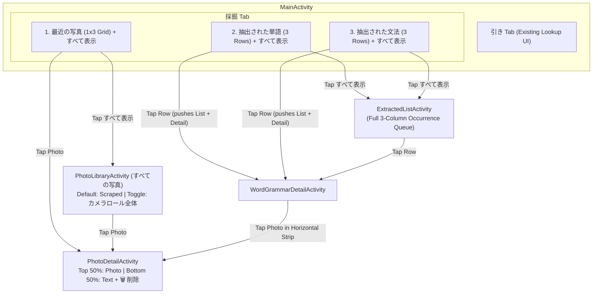
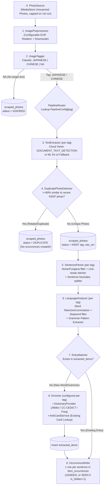
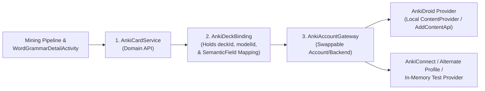

# Design Document: `引き` & `採掘` Navigation and Photo Mining Pipeline

## 1. Goal Description

1. Add a bottom navigation bar (`BottomNavigationView`) to **AnkiBiki** with two tabs:
   - **引き (`ひき`)** — Existing dictionary and Anki card lookup screen.
   - **採掘 (`さいくつ`)** — New photo sentence-mining pipeline and triage interface, localized entirely in Japanese.
2. Build the **採掘** main dashboard with **three stacked sections**:
   - **Section 1 (`最近の写真` - Top ~1/5 of page):** A 1-row, 3-column gallery preview showing the 3 most recently scraped photos (`status = 'KEEP'`), followed by a **すべて表示** ("See all") button.
   - **Section 2 (`抽出された単語` - Extracted Words):** Shows 3 preview rows of unseen word occurrences (sorted newest-first via an extensible query spec) with columns for **単語** (Kanji/kana only, no furigana), **デッキ** (Anki deck name if card exists), and **頻度** (both **scraped occurrence count** and **JLPT level / corpus frequency rank**), followed by a **すべて表示** button.
   - **Section 3 (`抽出された文法` - Extracted Grammar):** Shows 3 preview rows of unseen grammar occurrences with the same columns (**文法**, **デッキ**, **頻度**), followed by a **すべて表示** button.
3. Build the **Photo Library & Detail** screens:
   - **Full Photo Library Screen (`すべての写真`):** Google Photos-style 3-column grid ordered newest-first. Shows **scraped photos by default**, with a top toggle (`カメラロール全体`) to switch to the full camera roll.
   - **Photo Detail Screen:** Top half displays the photo; bottom half displays the extracted text and a trash can button (`削除`) at the bottom that removes the photo from AnkiBiki and marks it as ignored (`DELETED`).
4. Build the **Occurrence Queue ("See All") & Word/Grammar Detail** screens:
   - **1 occurrence per sentence:** Each sentence containing a target word/grammar in a scraped photo enters the list as its own occurrence entry.
   - Clicking **すべて表示** opens the full occurrence list (`ExtractedListActivity`).
   - Clicking a preview row on the main `採掘` tab opens the full list page **and** immediately launches the **Word/Grammar Detail** page on top of it (so pressing Back returns to the full list).
   - **Word/Grammar Detail Screen (`WordGrammarDetailActivity`):**
     1. Horizontally scrollable photo strip of all scraped photos containing this target word (no "See all" button).
     2. The target word on its own line.
     3. Three tap-to-reveal rows: **漢字: 表示**, **かな: 表示**, **意味: 表示**.
     4. Corpus frequency (JLPT level first if it exists, plus corpus rank & occurrence count).
     5. All original sentences from your photos matching this word (no English translation).
     6. Four action buttons at the bottom: **Create/See Anki Card** (lookup active in v1; card creation deferred to its own design), **Mark as Seen**, **Hide**, and **Delete**.
5. Build a **Tag-Parameterized, Modular Extraction Pipeline** where each stage (`PhotoSource`, `ImagePreprocessor`, `ImageTagger`, `TextExtractor`, `DuplicatePhotoDetector`, `SentenceParser`, `WordAnalyzer`, `GrammarAnalyzer`, `DictionaryProvider`, `AnkiCardService`) is behind an independent interface and parameterized by `LanguageTag` (`JAPANESE`, `CHINESE`, `NA`, etc.).
6. Introduce a **Decoupled Anki Integration Layer (`AnkiAccountGateway` + `AnkiDeckBinding` + `AnkiCardService`)** using immutable `deckId` and `modelId` keys inside swappable configuration objects.

---

## 2. Japanese UI Strings Reference

All UI elements in the **採掘** flow use natural Japanese strings:

| English Meaning | Japanese String | Reading / Notes |
| :--- | :--- | :--- |
| **Lookup (Tab 1)** | `引き` | *Hiki* (from *辞書を引く* / *AnkiBiki*) |
| **Mining (Tab 2)** | `採掘` | *Saikutsu* (Mining / Excavation) |
| **Scan New Photos** | `スキャン` | *Sukyan* (Triggers pipeline on recent unscanned photos) |
| **Recent Photos (Section 1)** | `最近の写真` | *Saikin no shashin* |
| **Extracted Words (Section 2)** | `抽出された単語` | *Chūshutsu sareta tango* |
| **Extracted Grammar (Section 3)** | `抽出された文法` | *Chūshutsu sareta bunpō* |
| **Column: Word / Grammar** | `単語` / `文法` | *Tango* / *Bunpō* (Kanji/kana only, no furigana) |
| **Column: Deck Name** | `デッキ` | *Dekki* (or `—` when no card exists) |
| **Column: Frequency** | `頻度` | *Hindo* — formatted as `<count>回 · <JLPT/Rank>` (e.g., `3回 · N2 #1420`) |
| **See All** | `すべて表示` | *Subete hyōji* |
| **All Photos (Library Title)** | `すべての写真` | *Subete no shashin* |
| **Camera Roll Toggle** | `カメラロール全体` | *Kamera rōru zentai* |
| **Extracted Text (Header)** | `抽出されたテキスト` | *Chūshutsu sareta tekisuto* |
| **Kanji: Reveal** | `漢字: タップして表示` | *Kanji: Tappu shite hyōji* |
| **Kana: Reveal** | `かな: タップして表示` | *Kana: Tappu shite hyōji* |
| **Meaning: Reveal** | `意味: タップして表示` | *Imi: Tappu shite hyōji* |
| **Corpus Frequency Label** | `コーパス頻度` | *Kōpasu hindo* (e.g., `3回 · JLPT N2 · ランク #1,420`) |
| **Matched Sentences Header** | `例文` | *Reibun* (Original sentences from photos) |
| **Create Anki Card** | `カードを作成` | *Kādo o sakusei* (Stubbed for future card-creation design) |
| **See Anki Card** | `カードを表示` | *Kādo o hyōji* (Shown when card already exists) |
| **Mark as Seen** | `既読` | *Kidoku* ("Mark as seen/read") |
| **Hide** | `非表示` | *Hihyōji* ("Hide this word & skip future occurrences") |
| **Delete** | `削除` | *Sakujo* ("Delete/unlink this single occurrence") |

---

## 3. Screen Layouts & User Flow



### Wireframes: Main `採掘` Tab & Occurrence List

```text
+--------------------------------------------+   +--------------------------------------------+
| [採掘 Tab - MainActivity]        [スキャン] |   | [抽出された単語 - ExtractedListActivity]    |
|                                            |   | <- 抽出された単語                           |
| 最近の写真                                  |   | 単語         デッキ         頻度            |
| +-----------+ +-----------+ +------------+ |   | ------------------------------------------ |
| |  Photo 1  | |  Photo 2  | |  Photo 3   | |   | 証拠         🇯🇵 JP Vocab    3回 · N2 #1420 |
| +-----------+ +-----------+ +------------+ |   | 矛盾         —              2回 · N1 #2810 |
|                              [すべて表示 >] |   | 証拠         🇯🇵 JP Vocab    3回 · N2 #1420 |
| ------------------------------------------ |   | 検事         🇯🇵 JP Vocab    1回 · N1 #3105 |
| 抽出された単語                              |   | 現場         —              4回 · N3 #890  |
| 単語         デッキ         頻度            |   | ...                                        |
| 証拠         🇯🇵 JP Vocab    3回 · N2 #1420 |   +--------------------------------------------+
| 矛盾         —              2回 · N1 #2810 |
| 検事         🇯🇵 JP Vocab    1回 · N1 #3105 |
|                              [すべて表示 >] |
| ------------------------------------------ |
| 抽出された文法                              |
| 文法         デッキ         頻度            |
| というわけだ 🇯🇵 JP Grammar  4回 · N3 #620  |
| ざるを得ない —              2回 · N2 #1890 |
| に違いない   🇯🇵 JP Grammar  1回 · N3 #940  |
|                              [すべて表示 >] |
+--------------------------------------------+
|          [ 引き ]       [ *採掘* ]          |
+--------------------------------------------+
```

### Wireframe: Word / Grammar Detail Screen (`WordGrammarDetailActivity`)

```text
+--------------------------------------------+
| <-                                         |
| +----------+ +----------+ +----------+ +---|
| | Photo A  | | Photo B  | | Photo C  | | P |  <-- Horizontally scrollable photos
| |          | |          | |          | | h |      containing this word (no "See all")
| +----------+ +----------+ +----------+ +---|
|                                            |
| 証拠                                        |  <-- Target word on its own line
|                                            |
| 漢字:  [ タップして表示 ]                   |  <-- Tap to reveal: 証拠
| かな:  [ タップして表示 ]                   |  <-- Tap to reveal: しょうこ
| 意味:  [ タップして表示 ]                   |  <-- Tap to reveal: evidence; proof
|                                            |
| 頻度:  3回 · JLPT N2 · ランク #1,420        |  <-- Occurrence count + JLPT + Corpus rank
|                                            |
| 例文 (一致した文)                           |  <-- All original sentences (no EN)
| • しかし決定的な証拠がまだ足りない…          |
| • この証拠品を法廷で突きつけるしかない！      |
| • 証拠隠滅の恐れがあります。                 |
|                                            |
| +----------------------------------------+ |
| |        [ カードを作成 / カードを表示 ]     | |  <-- See Card (v1) / Create Card (future)
| +----------------------------------------+ |
| |   [ 既読 ]     [ 非表示 ]     [ 削除 ]    | |  <-- Mark as Seen | Hide | Delete
| +----------------------------------------+ |
+--------------------------------------------+
```

---

## 4. Occurrence Lifecycle, Granularity & Button Semantics

* **Granularity (1 Occurrence per Sentence):** Each sentence in a non-duplicate photo where a target word/grammar appears creates its own `item_occurrences` row. (So if `"証拠だ！この証拠を見ろ！"` has two sentences containing `証拠`, that creates 2 occurrence rows).
* **Extensible Sorting & Filtering (`OccurrenceQuery`):**
  - Default sort order is **Newest First** (`OccurrenceSortOrder.NEWEST_FIRST`).
  - `MiningRepository.getActiveOccurrences(query: OccurrenceQuery)` accepts a structured query specification (`sortOrder`, `filters`, `limit`) so additional sort modes (`OCCURRENCE_COUNT_DESC`, `CORPUS_RANK_ASC`, `LEVEL_ASC`) and filters (`HAS_CARD`, `NO_CARD`) can be added in the future without changing repository signatures.

| Action | Button Label | What It Does | Effect on Future Occurrences & Linked Data |
| :--- | :--- | :--- | :--- |
| **Mark as Seen** | `既読` | Sets this occurrence's state from `UNSEEN` $\rightarrow$ `SEEN`. Removes this entry from the active occurrence list. | **Stays linked** to the word (its photo & sentence still show on the word detail page and count toward occurrence count). **Future occurrences** in new photos will enter as `UNSEEN` and appear in the list again. |
| **Hide** | `非表示` | Sets `is_hidden = 1` on the canonical `extracted_items` record and marks its `UNSEEN` occurrences as `SEEN`. | **Future occurrences automatically skip** the active occurrence list (they are recorded directly as `SEEN` so the inbox is never cluttered with this word again). |
| **Delete** | `削除` | Sets this specific occurrence's state to `DELETED` (unlinking it). | **Unlinks only this single occurrence**: it will not show up in the list, in the word's photo strip, or in the word's matched sentences, and decrements the occurrence count by 1. The canonical word entry, any existing Anki card, and any other occurrences of the same word are **completely unaffected**. |
| **Create / See Anki Card** | `カードを作成` / `カードを表示` | If `anki_note_id` exists on the canonical item, `カードを表示` opens/displays the existing card. If not, `カードを作成` is shown (card creation flow deferred to a dedicated design phase). | Read-only lookup runs automatically in Step 5 of the pipeline. |

---

## 5. Tag-Parameterized Mining Pipeline Architecture

### 5.1 End-to-End Pipeline Flow



### 5.2 Pipeline & Image Preprocessing Configuration (`PipelineConfig`)

Every tag's pipeline and image preprocessing parameters are driven by declarative config objects so a future UI can adjust them without touching pipeline logic:

```kotlin
enum class LanguageTag {
    JAPANESE,
    CHINESE,
    NA, // Not Applicable (regular non-text photo)
}

data class ImagePreprocessConfig(
    val maxLongEdgePx: Int = 1600,     // Downscale target before OCR upload
    val jpegQuality: Int = 85,         // Compression quality (1..100)
    val autoRotateExif: Boolean = true, // Apply EXIF orientation before OCR
)

data class ScanDiscoveryConfig(
    val initialBackfillLimit: Int = 50, // Cap on first-run scan of DCIM/Camera
    val batchSize: Int = 25,
)

data class DuplicateDetectionConfig(
    val enabled: Boolean = true,
    val similarityThreshold: Double = 0.90, // Normalized Levenshtein / bigram similarity
    val lookbackPhotoCount: Int = 10,       // Compare against N most recent KEEP photos
)

data class PipelineConfig(
    val tag: LanguageTag,
    val imagePreprocessConfig: ImagePreprocessConfig = ImagePreprocessConfig(),
    val duplicateDetectionConfig: DuplicateDetectionConfig = DuplicateDetectionConfig(),
    val textExtractor: TextExtractor,
    val duplicateDetector: DuplicatePhotoDetector,
    val sentenceParser: SentenceParser,
    val wordAnalyzer: WordAnalyzer,
    val grammarAnalyzer: GrammarAnalyzer,
    val dictionaryProviders: List<DictionaryProvider>,
    val ankiBindings: Map<ItemType, List<AnkiDeckBinding>>,
)
```

### 5.3 Stage-by-Stage Breakdown & Kotlin Interfaces

#### Step 0: Photo Discovery (`PhotoSource`)
* **Responsibility:** Queries `MediaStore.Images.Media` for photos not yet present in `scraped_photos`, respecting `ScanDiscoveryConfig.initialBackfillLimit` on first run so thousands of old camera roll photos aren't scanned automatically.
* **Interface:**
  ```kotlin
  interface PhotoSource {
      fun findUnprocessedPhotos(config: ScanDiscoveryConfig): List<PhotoCandidate>
  }
  ```

#### Step 1: Image Preprocessing (`ImagePreprocessor`)
* **Responsibility:** Reads EXIF orientation from the `ContentResolver` stream, rotates the bitmap right-side up, and downscales it to `config.maxLongEdgePx` / `config.jpegQuality` so sideways DS photos are oriented properly and uploads to Cloud Vision are fast (~150 KB instead of 10 MB).
* **Interface:**
  ```kotlin
  data class PreparedImage(val bitmap: Bitmap, val jpegBytes: ByteArray)

  interface ImagePreprocessor {
      fun prepare(photo: PhotoCandidate, config: ImagePreprocessConfig): PreparedImage
  }
  ```

#### Step 2: Image Tagging & Triage (`ImageTagger`)
* **Responsibility:** Runs a fast, free, on-device pass over `PreparedImage` to classify its `LanguageTag` (`JAPANESE`, `CHINESE`, `NA`).
  - If Hiragana/Katakana (`[\u3040-\u30FF]`) is detected above threshold $\rightarrow$ `JAPANESE`.
  - Else if CJK ideographs are detected $\rightarrow$ disambiguate `JAPANESE` vs. `CHINESE` using simplified/shinjitai character tables (`shinjitai.db` / `cedict`).
  - Else $\rightarrow$ `NA` (marked `IGNORED` in DB so it's never scanned again).
* **Interface:**
  ```kotlin
  interface ImageTagger {
      fun classify(image: PreparedImage): TagResult
  }
  ```

#### Step 3: Image Text Extraction (`TextExtractor`)
* **Responsibility:** Extracts structured text blocks, lines, and bounding boxes from a tagged photo.
  - Reads `CLOUD_VISION_API_KEY` from `local.properties` via `BuildConfig`. If present and online, calls Cloud Vision `DOCUMENT_TEXT_DETECTION`; otherwise falls back to on-device ML Kit v2.
* **Interface:**
  ```kotlin
  data class OcrBlock(val text: String, val lines: List<OcrLine>)
  data class OcrLine(val text: String, val boundingBoxHeightPx: Int?)
  data class OcrDocument(val fullText: String, val blocks: List<OcrBlock>)

  interface TextExtractor {
      fun extract(image: PreparedImage): OcrDocument
  }
  ```

#### Step 4: Duplicate / Retake Detection (`DuplicatePhotoDetector`)
* **Responsibility:** Compares the extracted `OcrDocument.fullText` against the most recent `KEEP` photos (`lookbackPhotoCount`).
  - If similarity $\ge$ `similarityThreshold` (e.g., you took a second photo of the exact same DS dialogue screen because of glare), the photo is saved in `scraped_photos` with `status = 'DUPLICATE'` and `duplicate_of_photo_id` pointing to the original photo.
  - **Crucial:** A `DUPLICATE` photo **stops here**—it creates **zero** `item_occurrences` and does **not** touch `extracted_items`, while remaining tagged as `DUPLICATE` in `scraped_photos` so a future UI feature can let you manually review duplicates!
* **Interface:**
  ```kotlin
  data class DuplicateCheckResult(val isDuplicate: Boolean, val duplicateOfPhotoId: Long?)

  interface DuplicatePhotoDetector {
      fun checkDuplicate(
          extractedText: String,
          tag: LanguageTag,
          config: DuplicateDetectionConfig,
      ): DuplicateCheckResult
  }
  ```

#### Step 5: Sentence Parsing & Line-Break Stitching (`SentenceParser`)
* **Responsibility:** Converts an `OcrDocument` into clean, self-contained sentences.
  1. Drops UI noise (`START`, `SELECT`, `A`, `B`) and furigana lines (lines whose bounding-box height is $< 55\%$ of the median line height in the block).
  2. Joins soft line wraps inside a dialogue box (`決定的な証\n拠がまだ足りない` $\rightarrow$ `決定的な証拠がまだ足りない`).
  3. Splits on sentence-terminal punctuation (`。`, `！`, `？`, `…`).
* **Interface:**
  ```kotlin
  interface SentenceParser {
      fun parseSentences(document: OcrDocument): List<String>
  }
  ```

#### Step 6: Word & Grammar Normalization (`WordAnalyzer` & `GrammarAnalyzer`)
* **Responsibility:**
  - **`WordAnalyzer`:** Tokenizes each sentence, lemmatizes conjugated verbs/adjectives to their dictionary base form (`基本形`, e.g., `食べさせられた` $\rightarrow$ `食べる`), ensures pure Kanji/kana headword (no furigana), and filters out particles (`助詞`), auxiliary verbs (`助動詞`), punctuation, and stopwords.
  - **`GrammarAnalyzer`:** Identifies grammar constructions in the sentence and normalizes them to their canonical form (e.g., `ざるを得なかった` $\rightarrow$ `ざるを得ない`).
* **Interfaces:**
  ```kotlin
  data class NormalizedCandidate(
      val expression: String, // Canonical headword (Kanji or kana, no furigana)
      val surfaceForm: String, // Exact substring as it appeared in the sentence
      val readingKana: String?, // Optional reading from tokenizer
  )

  interface WordAnalyzer {
      fun extractWords(sentence: String): List<NormalizedCandidate>
  }

  interface GrammarAnalyzer {
      fun extractGrammar(sentence: String): List<NormalizedCandidate>
  }
  ```

#### Step 7: Entry Matching, Dictionary Lookup & Anki Lookup (`DictionaryProvider` & `AnkiCardService`)
* **Responsibility:**
  - For each sentence and each `NormalizedCandidate` in that sentence:
    - Checks if `(tag, itemType, expression)` already exists in `extracted_items`.
    - If **not found**, queries the tag's configured `DictionaryProvider`s (for `kanji`, `kana`, `meaning`, `levelBadge`, `corpusRank`) and the tag's configured `AnkiDeckBinding`s via `AnkiCardService.findMatch(...)` (for `deckId`, `deckName`, and `ankiNoteId`), then creates the canonical `extracted_items` row.
    - Records **1 `item_occurrences` row per sentence** linking `(photo_id, sentence, expression)` with state `UNSEEN` (or `SEEN` if `is_hidden == 1`).

---

## 6. Encapsulated Anki Integration Architecture

### 6.1 Critique of the Existing Anki Implementation (`KnownNoteTypes.kt` & `AnkiRepository.kt`)

In the existing codebase, Anki integration has three architectural issues that make swapping accounts, decks, or note types brittle:
1. **Global Compile-Time Constants Instead of Swappable Config Objects:**
   `CHINESE_MNEMONICS_MODEL_ID`, `NIHONGO_SHARK_KANJI_MODEL_ID`, and `CHINESE_WORD_DECK_ID` are hardcoded as global top-level constants in `KnownNoteTypes.kt` and referenced directly inside adapters and services, rather than encapsulated inside a swappable account/deck configuration.
2. **Scattered Positional Field Indices (`CHARACTER_FIELD_INDEX = 2`, `MNEMONIC_FIELD = 10`):**
   Magic field indices (`fields[4]`) are scattered across `KnownNoteTypes.kt` and `CardAdapters.kt` with no schema validation against `getFieldList(modelId)`.
3. **Storing Deck Display Names Instead of `deckId`:**
   In Anki's SQLite schema, `deckId` (`did`) and `modelId` (`mid`) are the true immutable primary keys within an account's collection—if you rename a deck (e.g., `"JP Vocab"` $\rightarrow$ `"Japanese::Vocab"`), its `deckId` stays the same while its name changes.

### 6.2 New 3-Layer Anki Abstraction for the Pipeline (Forward-Compatible)

We will build the new pipeline against a clean, self-contained **3-layer Anki architecture** (`com.derricklee.ankidict.anki`) that uses **`deckId: Long`** and **`modelId: Long`** as stable primary keys inside a swappable **`AnkiDeckBinding`** config.
* **v1 Scope:** Existing card lookup (`findMatch` + `openCardInAnki`) is fully implemented in v1. Card creation (`createCard`) is defined on the interface as an extension point and deferred to its own dedicated design phase.



---

## 7. Database Schema (`mining.db`)

Managed by `MiningRepository.kt` via `SQLiteOpenHelper`:

```sql
-- 1. Scraped Photos (caches raw OCR so NLP stages can be re-run anytime offline)
CREATE TABLE scraped_photos (
    media_store_id INTEGER PRIMARY KEY,
    content_uri TEXT NOT NULL,
    date_added INTEGER NOT NULL,
    language_tag TEXT NOT NULL,         -- 'JAPANESE', 'CHINESE', 'NA'
    extracted_text TEXT NOT NULL,       -- Plain text for display
    ocr_blocks_json TEXT,               -- Raw OcrDocument JSON for offline re-parsing
    status TEXT NOT NULL,               -- 'KEEP', 'IGNORED', 'DELETED', 'DUPLICATE'
    duplicate_of_photo_id INTEGER       -- If status = 'DUPLICATE', references original media_store_id
);

CREATE INDEX idx_scraped_photos_status_date
    ON scraped_photos(status, date_added DESC);

-- 2. Canonical Word / Grammar Entries (parameterized by language_tag + item_type)
CREATE TABLE extracted_items (
    language_tag TEXT NOT NULL,         -- 'JAPANESE', 'CHINESE'
    item_type TEXT NOT NULL,            -- 'WORD' or 'GRAMMAR'
    expression TEXT NOT NULL,           -- Kanji or kana headword (no furigana), e.g. "証拠"
    kanji TEXT NOT NULL,                -- Revealed by "Kanji: Reveal"
    kana TEXT NOT NULL,                 -- Revealed by "Kana: Reveal" (or Pinyin for Chinese)
    meaning TEXT NOT NULL,              -- Revealed by "Meaning: Reveal"
    level_badge TEXT,                   -- e.g. "N2" for JP or "HSK 3" for ZH
    corpus_rank INTEGER,                -- Corpus frequency rank (e.g. 1420), else NULL
    anki_account_id TEXT,               -- Account ID where the card matched
    deck_id INTEGER,                    -- Immutable Anki deckId if card exists, else NULL
    deck_name TEXT,                     -- Cached display name (resolved from deck_id)
    anki_note_id INTEGER,               -- Anki note ID if card exists, else NULL
    is_hidden INTEGER NOT NULL DEFAULT 0, -- 1 when user clicks "Hide" (非表示)
    PRIMARY KEY (language_tag, item_type, expression)
);

-- 3. Individual Occurrences (1 row per sentence in a non-duplicate KEEP photo)
CREATE TABLE item_occurrences (
    id INTEGER PRIMARY KEY AUTOINCREMENT,
    language_tag TEXT NOT NULL,         -- 'JAPANESE', 'CHINESE'
    item_type TEXT NOT NULL,            -- 'WORD' or 'GRAMMAR'
    expression TEXT NOT NULL,           -- References extracted_items
    photo_id INTEGER NOT NULL,          -- References scraped_photos(media_store_id)
    sentence TEXT NOT NULL,             -- Original sentence from the photo
    created_at INTEGER NOT NULL,        -- Timestamp
    state TEXT NOT NULL                 -- 'UNSEEN', 'SEEN', 'DELETED'
);

CREATE INDEX idx_occurrences_active
    ON item_occurrences(language_tag, item_type, state, created_at DESC);

CREATE INDEX idx_occurrences_item
    ON item_occurrences(language_tag, item_type, expression, state);
```

---

## 8. Phased Implementation Plan

### Phase 1: UI Foundation, Navigation & SQLite Data Layer
1. Add `BottomNavigationView` (`引き` / `採掘`) to `MainActivity` and `activity_main.xml`.
2. Implement `MiningModels.kt` and `MiningRepository.kt` (`mining.db` with `scraped_photos`, `extracted_items`, `item_occurrences`, and extensible `OccurrenceQuery` sorting/filtering).
3. Implement the `採掘` tab dashboard (`最近の写真` 1x3 preview, `抽出された単語` 3-row preview, `抽出された文法` 3-row preview, and `スキャン` button).
4. Implement `PhotoLibraryActivity` (`すべての写真` with `カメラロール全体` toggle) and `PhotoDetailActivity` (top half photo, bottom half text + `🗑️ 削除`).
5. Implement `ExtractedListActivity` (full 3-column queue) and `WordGrammarDetailActivity` (horizontal photo strip, tap-to-reveal `漢字`/`かな`/`意味`, frequency line, matched sentences, and `既読`/`非表示`/`削除`/`カードを表示` actions).

### Phase 2: Tag-Parameterized OCR & NLP Extraction Pipeline
1. Implement `PipelineContracts.kt`, `ImagePreprocessor` (EXIF rotation + configurable downscaling), and `PhotoSource` (with initial backfill cap).
2. Implement `MlKitImageTagger` (`JAPANESE`, `CHINESE`, `NA`), `CloudVisionTextExtractor` (reading `CLOUD_VISION_API_KEY` from `local.properties` via `BuildConfig`), and `MlKitTextExtractor` (offline fallback).
3. Implement `DuplicatePhotoDetector` (tagging retakes as `PhotoStatus.DUPLICATE` without creating occurrences).
4. Implement `CjkSentenceParser` (furigana height filter + line-wrap stitcher + sentence splitter), `KuromojiWordAnalyzer`, and `JlptGrammarAnalyzer` + bundled frequency/grammar lookup tables.

### Phase 3: Encapsulated Anki Lookup Integration
1. Implement `AnkiAccountGateway` (`AnkiDroidAccountGateway`), `AnkiDeckBinding`, and `AnkiCardService` (read-only existing card lookup by `deckId`/`modelId` + opening existing cards, with `createCard` stubbed for its future design).
2. Wire `AnkiCardService` into Step 7 of `MiningPipelineRunner` and `WordGrammarDetailActivity`.

---

## 9. Verification Plan

### Automated Build & Unit Verification
```bash
cd /home/derri/workspace/ankibiki && ./gradlew assembleDebug testDebugUnitTest
```
- Unit tests for:
  - `DuplicatePhotoDetector` (verifying `DUPLICATE` photos create zero occurrences and do not affect entities).
  - `CjkSentenceParser` (line-stitching across wrapped words, furigana filtering).
  - `MiningRepository` (1 occurrence per sentence, `OccurrenceQuery` sorting, `既読` vs `非表示` vs `削除` semantics).
